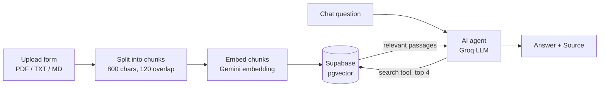

# n8n RAG Knowledge Base Demo

A document Q&A assistant built in **n8n**. Upload PDFs, and a chat agent answers questions **only from those documents**, cites its source, and says "I couldn't find that" when the answer isn't there.

> The demo uses **fictional** documents from an imaginary coffee store ("Northwind Roasters"). No real company data is included.

## How it works

| Workflow | Purpose |
|---|---|
| `RAG-01 - Document Ingestion` | Form upload → chunking → embeddings → Supabase |
| `RAG-02 - Knowledge Base Q&A` | Chat agent that retrieves passages and answers with the source cited |

**Stack:** n8n, Supabase (pgvector), Google Gemini embeddings (`gemini-embedding-001`, 3072 dims), Groq (`gpt-oss-120b`). All used on free tiers.

## Behaviour rules (in the agent's system prompt)

- Always search the knowledge base first; answer only from retrieved text.
- Never invent prices, dates, policies or contact details.
- If the documents don't contain the answer, say so (and offer a contact from the documents if one exists).
- Questions unrelated to the company are politely declined.
- Cite the source document at the end of each grounded answer.
- Search once per question (capped iterations) to stay within rate limits.

## Testing

`rag-demo-test-sheet.xlsx` contains 20 test questions in four groups:

- answer is in a single document
- answer needs two documents (cross-document)
- answer is **not** in the documents (the bot must refuse, not guess)
- unrelated question (the bot must decline)

**Result: [20/20] passed.** <!-- replace with your real number and one honest note on any failure -->

## Setup

1. Create a Supabase project and run `supabase-setup-rag-demo-gemini.sql` in the SQL editor.
2. In n8n, create credentials: Supabase (service role key), Google Gemini (PaLM) API, Groq API.
3. Import `RAG-01-Document-Ingestion-Free.json` and `RAG-02-Knowledge-Base-QA-Free.json`, then select your credentials on the Supabase, embeddings and chat model nodes.
4. Execute RAG-01 and upload the PDFs in `sample-documents/` (once each).
5. Open the RAG-02 chat and ask the questions from the test sheet.

The workflows contain only credential placeholders, never real keys.

## Known limitations

- Re-uploading the same file stores duplicate chunks (no de-duplication yet).
- Free-tier rate limits (Groq tokens per minute) can interrupt rapid-fire testing.
- Tested on three short documents; chunk size and `topK` should be tuned for larger or messier documents.
- No vector index: exact search is fine at demo scale; for large collections use a smaller embedding dimension with an index.

## What I'd adapt for a real project

- Document types and loaders (Google Drive, Notion, scanned PDFs with OCR)
- Chunk size, overlap and `topK` tuned on your documents
- Answer tone, languages and escalation to a human
- Where it runs: chat widget, WhatsApp or internal tool
- De-duplication, access control and a larger rate-limit tier
